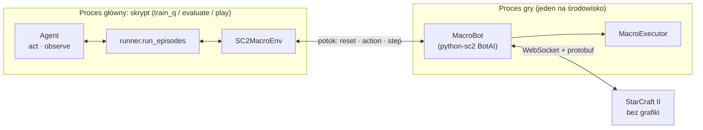
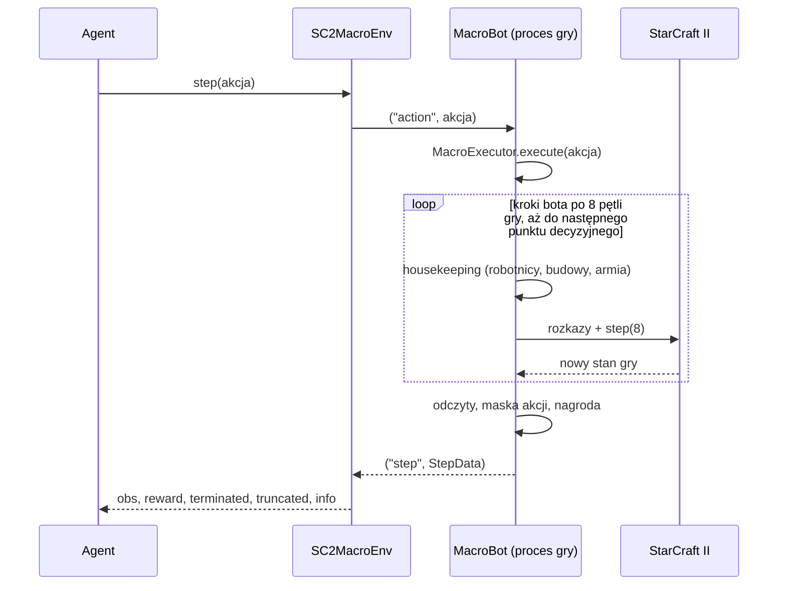

# Architektura

Projekt ma trzy warstwy. Każda zna tylko tę pod sobą.

| Warstwa | Co robi | Gdzie |
|---------|---------|-------|
| Agenci i skrypty | Wybierają akcję makro, uczą się, logują wyniki | `src/scbot/agents/`, `train_q.py`, `evaluate.py`, `play.py` |
| Wspólne środowisko | Zamienia grę na ciąg punktów decyzyjnych: obserwacja, maska akcji, nagroda | `src/scbot/env/` |
| Gra | StarCraft II sterowany biblioteką python-sc2 (BurnySC2) | obraz Dockera lub klient Windows |

Agent nie widzi gry ani python-sc2. Dostaje wektor liczb i zwraca numer akcji. Dzięki temu
tabelaryczny Q-Learning, DQN i PPO grają na identycznych zasadach, a różnice w wynikach
biorą się z decyzji, nie z jakości sterowania jednostkami.

## Mapa modułów

| Plik | Rola | Obszar z podziału zadań |
|------|------|-------------------------|
| `env/sc2_env.py` | `SC2MacroEnv`: interfejs Gymnasium, zarządzanie procesem gry | Integracja API (Mikołaj) |
| `env/worker.py` | Proces gry: uruchamia mecze python-sc2 i rozmawia ze środowiskiem | Integracja API (Mikołaj) |
| `env/bot.py` | `MacroBot`: bot python-sc2, który w punktach decyzyjnych pyta o akcję | Integracja API (Mikołaj) |
| `env/bridge.py` | `StepData` i protokół wymiany decyzji | Integracja API (Mikołaj) |
| `env/decision_points.py` | Reguła, kiedy agent jest pytany o akcję | Integracja API (Mikołaj) |
| `env/observation.py` | Lista cech i budowa wektora obserwacji | Obserwacje i nagrody (Robert) |
| `env/reward.py` | Funkcja nagrody | Obserwacje i nagrody (Robert) |
| `env/actions.py` | Lista akcji makro | Warstwa skryptowa (Piotr) |
| `env/macro.py` | `MacroExecutor`: wykonanie akcji makro, maska akcji, obsługa bazy i armii | Warstwa skryptowa (Piotr) |
| `config.py` | `EnvConfig`, `MacroConfig`, `RewardConfig` | wspólne |
| `agents/base.py` | Interfejs `Agent` | wspólne |
| `agents/simple.py` | Agent losowy i skryptowy (odniesienie, bez uczenia) | wspólne |
| `agents/qlearning.py` | Model A: dyskretyzacja stanu i tablica Q | Model A (Mikołaj) |
| `runner.py` | Pętla epizodów dla jednej lub wielu gier naraz | wspólne |
| `run_logging.py` | `episodes.csv`, `steps.jsonl`, TensorBoard | wspólne |
| `doctor.py`, `play.py`, `train_q.py`, `evaluate.py` | Skrypty uruchomieniowe | wspólne |

Części przypisane Robertowi i Piotrowi istnieją w wersji minimalnej, wystarczającej do
uruchomienia baseline'u. Mają stabilne interfejsy, więc można je rozwijać bez dotykania
reszty (patrz [rozwijanie.md](rozwijanie.md)).

## Procesy

Każde środowisko ma własny proces gry, a ten uruchamia własny proces StarCraft II. Proces
gry żyje przez wiele epizodów; StarCraft II jest startowany od nowa dla każdej gry.

Przy treningu równoległym (`--num-envs N`) proces główny ma N środowisk. Wszystkie decyzje
i wszystkie aktualizacje tablicy Q zapadają w procesie głównym, po kolei, więc jedna
tablica obsługuje wszystkie gry bez blokad. Równolegle działa tylko symulacja gry.

## Przebieg jednej decyzji

Gra nie biegnie w czasie rzeczywistym: czeka na bota po każdym kroku. Agent może więc
myśleć dowolnie długo bez wpływu na przebieg gry.

Następny punkt decyzyjny wypada najwcześniej po jednym interwale (4 kroki bota, 1,43 s
gry), a później, jeśli agent nie ma czego wybierać albo sam wybrał czekanie. Reguły są
w [srodowisko.md](srodowisko.md#punkty-decyzyjne).

Protokół na potoku jest ścisłą wymianą pytanie-odpowiedź (opis w nagłówku
`env/worker.py`):

| Kierunek | Komunikat | Znaczenie |
|----------|-----------|-----------|
| środowisko → gra | `("reset", {"seed", "replay_path"})` | Zacznij nową grę |
| środowisko → gra | `("action", int)` | Akcja makro dla bieżącego punktu decyzyjnego |
| środowisko → gra | `("close", None)` | Zakończ proces |
| gra → środowisko | `("step", StepData)` | Kolejny punkt decyzyjny albo koniec gry |
| gra → środowisko | `("error", traceback)` | Wyjątek w procesie gry |

## Decyzje projektowe

**Gra w osobnym procesie.** python-sc2 sam prowadzi pętlę zdarzeń i przy starcie gry
instaluje obsługę sygnału, co wymaga głównego wątku procesu. Dlatego nie da się go
schować w wątku za zwykłym `step()`. Osobny proces daje też izolację awarii (zawieszona
gra jest zabijana razem z procesem StarCraft II i startowana od nowa) oraz równoległość.

**Potok zamiast pliku.** Projekt sentdexa, od którego wyszliśmy, wymienia stan przez plik
`pickle` odczytywany w pętli przez oba procesy. Potok nie wymaga odpytywania, nie gubi
komunikatów i pozwala czekać na wiele gier jednocześnie.

**Maska akcji zamiast kar.** Środowisko mówi, które akcje da się teraz wykonać
(`info["action_mask"]`). Akcja spoza maski jest ignorowana i odnotowana w
`info["last_action_executed"]`. Agent nie musi uczyć się na własnych błędach, że nie stać
go na koszary.

**Agent jest pytany tylko wtedy, gdy ma wybór.** Punkty decyzyjne nie wypadają co stały
odstęp czasu. Pominięte są chwile, w których jedyną opcją jest `NO_OP`, a wybór `NO_OP`
oznacza czekanie do 10 sekund. Powód i pomiary: [srodowisko.md](srodowisko.md#punkty-decyzyjne).

**Zlecony budynek rezerwuje minerały.** Gra pobiera koszt dopiero przy rozpoczęciu
budowy, więc do tego czasu warstwa skryptowa nie pozwala wydać tych pieniędzy na nic
innego. Akcja „zbuduj X" ma dzięki temu przewidywalny skutek. Opis i pomiary:
[srodowisko.md](srodowisko.md#rezerwacja-minerałów).

**Rozkaz dla armii trwa minimum 30 sekund gry.** Po `ATTACK` lub `RETREAT` rozkaz
przeciwny jest przez ten czas niedostępny. Bez tego losowa eksploracja przełącza armię
co decyzję i jednostki nigdy nie dochodzą do bazy przeciwnika. Zmierzone przy niemal
losowych akcjach przeciw VeryEasy: przed wprowadzeniem blokady 4 gry z 4 skończyły się
remisem po 20 minutach, po niej 8 z 16 było wygranych. Razem z blokadą wydłużyliśmy odstęp
między decyzjami z 16 do 32 pętli gry, więc nie wiemy, ile daje każda zmiana z osobna.

**Ostatni krok czeka na zamknięcie gry.** Końcowy `StepData` jest wysyłany dopiero, gdy
python-sc2 zapisze powtórkę i zamknie grę. Dzięki temu po powrocie z ostatniego `step()`
plik powtórki jest kompletny.

**Numeracja epizodów przy grach równoległych.** Epizody są numerowane w kolejności startu
i w tej kolejności raportowane, nawet jeśli późniejsza gra skończy się wcześniej. Numer
w `episodes.csv`, w `steps.jsonl`, w nazwie powtórki i w nazwie checkpointu oznacza tę samą
grę. Ziarno gry numer `n` to `seed + n`.

## Co wzięliśmy z projektu sentdexa, a co zrobiliśmy inaczej

Punktem wyjścia był film [A.I. Learns to Play Starcraft 2](https://www.youtube.com/watch?v=q59wap1ELQ4)
i kod [Sentdex/SC2RL](https://github.com/Sentdex/SC2RL). Wspólny jest główny pomysł: sieć
(u nas najpierw tablica) wybiera jedną z kilku akcji makro, a skrypt w python-sc2 ją
wykonuje.

| | Sentdex/SC2RL | Ten projekt |
|---|---------------|-------------|
| Rasa i przeciwnik | Protoss (Void Raye) kontra Zerg, poziom Hard | Terran kontra Terran, poziom do wyboru |
| Obserwacja | Obraz 224×224×3 rysowany z pozycji jednostek | Wektor 24 cech liczbowych |
| Akcje | 6 akcji makro | 8 akcji makro z maską dostępności |
| Częstość decyzji | Każdy krok bota | Najwyżej co 32 pętle gry (1,43 s), tylko gdy jest wybór |
| Wymiana z grą | Plik `pickle` odpytywany w pętli, nowy proces Pythona na każdą grę | Potok, jeden proces gry na środowisko |
| Algorytm | PPO ze Stable Baselines 3 | Tabelaryczny Q-Learning; DQN i PPO w kolejnych etapach |
| Nagroda | ±500 na koniec, drobna nagroda za atakujące Void Raye | ±1 na koniec, drobne nagrody za produkcję i zniszczenia |
| Gry równoległe | Brak | Tak (`--num-envs`) |
| Logi | Weights & Biases | CSV, JSONL, TensorBoard |

## Ograniczenia

- Przeciwnikiem jest tylko wbudowana SI. Mecze bot kontra bot (turniej z etapu 4)
  wymagają dwóch instancji gry i osobnej pętli; python-sc2 to wspiera, kod projektu
  jeszcze nie.
- Każda gra startuje StarCraft II od nowa (kilka sekund). python-sc2 pozwala utrzymać
  proces gry między meczami, co skróciłoby krótkie epizody.
- Wersja linuksowa gry to 4.10, klient Windows jest nowszy (5.0.17). Kod działa na obu,
  ale wyniki z obu platform nie są wprost porównywalne.
- Gra, w której żadna strona nie zniszczy wszystkich budynków przeciwnika w 20 minut,
  kończy się remisem. Nie sprawdzaliśmy jeszcze, jaka część remisów to gry w praktyce
  rozstrzygnięte, w których przeciwnikowi zostały pojedyncze budynki.
